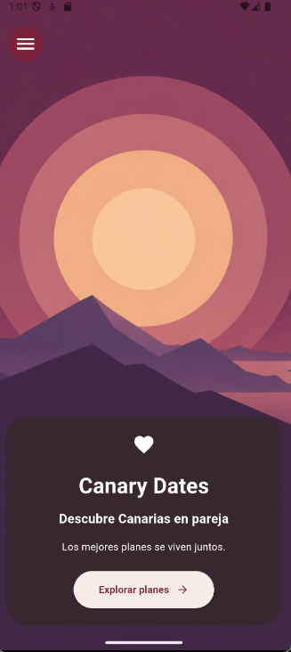
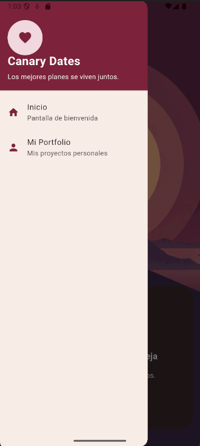
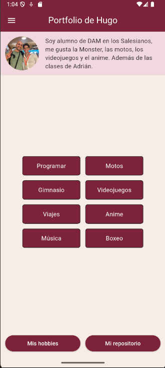
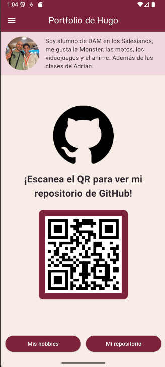

# Canary Dates ❤️

Aplicación móvil desarrollada en Flutter para descubrir planes en pareja por las Islas Canarias.

Proyecto de 2.º de Desarrollo de Aplicaciones Multiplataforma (DAM).

## Tecnologías utilizadas

- Flutter y Dart
- go_router para la navegación
- qr_flutter para generar el código QR

## Pantallas de la aplicación

### Pantalla de bienvenida

### Menú lateral (Drawer)

### Portfolio - Mis hobbies

### Portfolio - Mi repositorio

